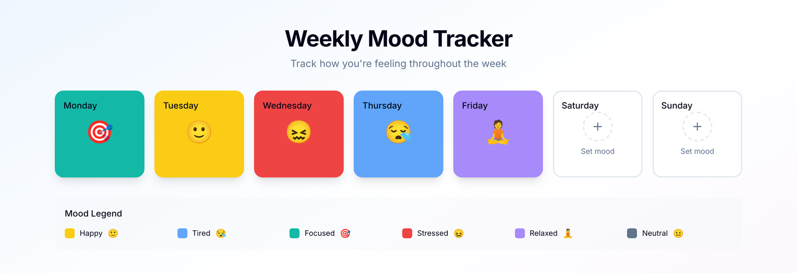
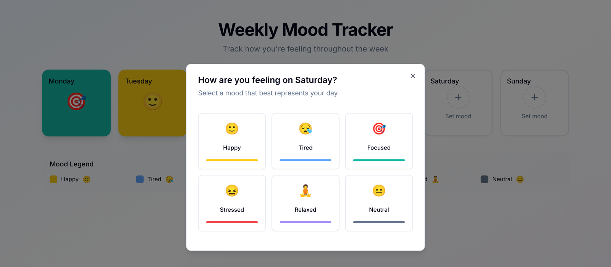

# Moody


A weekly mood board built with Next.js and React. Pick a mood for each day: the tile changes instantly while the choice is saved to a deliberately slow API in the background, and if the save fails, the tile rolls back and tells you why.



Next.js 15 (App Router) · React 19 · TypeScript (strict) · Tailwind CSS 4 · Radix UI · SQLite · Vitest + Testing Library

## Why I built this

This started as a small Next.js exercise, and I kept working on it because the part of frontend work I find most interesting is what happens between a click and the server's answer. The API here waits up to a second on every request on purpose. The board still has to feel instant, never end up showing a value the server doesn't have, and say clearly when something goes wrong.

I used an AI coding assistant while reworking it, like most people do now. I reviewed every change and can walk you through any file.

## Quick start

Requires Node 22 (see `.nvmrc`).

```bash
npm install
npm run dev
```

Open [http://localhost:3000](http://localhost:3000). The SQLite database (`moods.db`) is created on first run; delete the file to start over.

For a production build: `npm run build`, then `npm start`.

## How it works

- **Optimistic updates.** Choosing a mood updates the tile immediately. A spinner on the tile shows that the save is still in flight.
- **The latest choice wins.** Each day has at most one request in flight. If you change your mind while it is saving, the newest choice waits and is sent when that request finishes. Responses can't arrive out of order, so the server always ends up with what you picked last. Choices you made in between are skipped.
- **Rollback.** If the final save fails, the tile goes back to the last saved mood and a toast explains what went wrong.
- **Validation on the server.** The API accepts only known days and moods, checked against the same constants the UI uses. Anything else, including malformed JSON, is a `400`.
- **Slow on purpose.** Every API call waits 300–1200 ms (`app/api/lib/helpers.ts`), so all of the above is visible.
- **Accessible.** The board works with Tab, Enter and Esc, and Radix handles focus in the dialog. Tiles announce their mood and busy state, the picker marks the current mood with `aria-pressed`, and every label colour meets WCAG AA contrast, which a test checks.

The save logic lives in [`contexts/MoodContext.tsx`](contexts/MoodContext.tsx), next to the server state it updates.



## API

| Method          | Path             | Body                  | Response                                         |
| --------------- | ---------------- | --------------------- | ------------------------------------------------ |
| `GET`           | `/api/days`      |                       | The week, Monday to Sunday                       |
| `PUT` / `PATCH` | `/api/days/:day` | `{ "mood": "happy" }` | `{ "success": true, "data": { "day", "mood" } }` |

Moods: `happy`, `tired`, `focused`, `stressed`, `relaxed`, `neutral`. The day is case-insensitive. Invalid input returns `400` with `{ "error": "..." }`.

## Tests

```bash
npm test             # Vitest
npm run lint         # ESLint, fails on warnings
npm run typecheck
```

30 tests:

- **Components** (`MoodTile`, `MoodModal`, `MoodBoard`) through Testing Library, from the user's side, including keyboard-only use.
- **`MoodContext`**: optimistic display, one request per day at a time, the latest choice winning, rollback with an error toast, and retry when loading fails. The tests decide when each fake response arrives, so the ordering cases are deterministic.
- **API routes** against a real in-memory SQLite database.
- **Colour contrast** of every mood's label.

CI runs lint, typecheck, tests and the production build on every push to `main` and every pull request.

## Project structure

```text
app/
  page.tsx, layout.tsx, providers.tsx
  api/days/route.ts           GET /api/days
  api/days/[day]/route.ts     PUT/PATCH /api/days/:day
  api/lib/db/                 SQLite connection, schema and queries
  api/lib/helpers.ts          the artificial latency
  services/mood.api.ts        typed fetch client
components/
  MoodBoard/                  board, tile and mood picker
  ui/                         shadcn/ui primitives
contexts/MoodContext.tsx      server state, optimistic updates, save queue
constants/moods.ts            moods, colours, days and type guards
types/mood.types.ts
tests/                        Vitest + Testing Library
```

## Limitations and next steps

- **One week, no dates.** Monday to Sunday are fixed rows, so this is a board, not a history. The next step would be entries per date with week navigation.
- **One user.** There are no accounts.
- **One tab.** "The latest choice wins" holds within a browser tab. Two tabs editing the same day could still overwrite each other; the server would need a version per day to reject stale writes.
- **One server.** SQLite on local disk means it runs as a single Node process, not on serverless hosting.
- **No end-to-end tests yet.** The next addition would be a Playwright test of the slow-network and failure flows in a real browser.

## License

[MIT](LICENSE)
